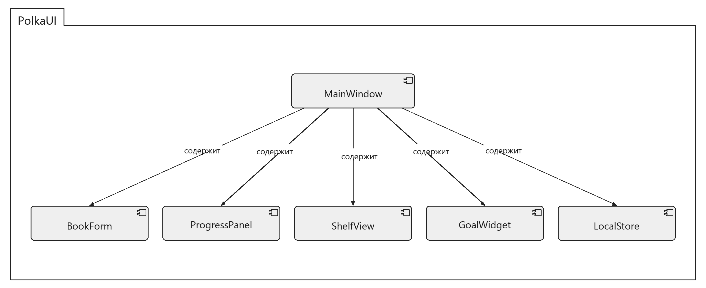
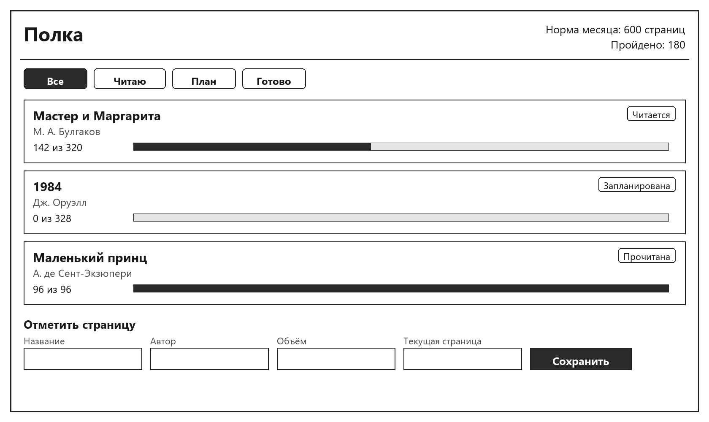

# Спецификация требований к ПО

Для приложения «Полка»

Версия 0.1

Подготовил(а) Кошель Ксения

БГУИР, кафедра электронных вычислительных машин

04.11.2026

## Оглавление

<!-- TOC -->
* [1. Введение](#1-introduction)
  * [1.1 Назначение документа](#11-document-purpose)
  * [1.2 Область применения продукта](#12-product-scope)
  * [1.3 Определения, акронимы и сокращения](#13-definitions-acronyms-and-abbreviations)
  * [1.4 Ссылки](#14-references)
  * [1.5 Обзор документа](#15-document-overview)
* [2. Обзор продукта](#2-product-overview)
  * [2.1 Перспектива продукта](#21-product-perspective)
  * [2.2 Функции продукта](#22-product-functions)
  * [2.3 Ограничения продукта](#23-product-constraints)
  * [2.4 Характеристики пользователей](#24-user-characteristics)
  * [2.5 Допущения и зависимости](#25-assumptions-and-dependencies)
  * [2.6 Распределение требований](#26-apportioning-of-requirements)
* [3. Требования](#3-requirements)
  * [3.1 Внешние интерфейсы](#31-external-interfaces)
    * [3.1.1 Пользовательские интерфейсы](#311-user-interfaces)
    * [3.1.2 Аппаратные интерфейсы](#312-hardware-interfaces)
    * [3.1.3 Программные интерфейсы](#313-software-interfaces)
  * [3.2 Функциональные требования](#32-functional)
  * [3.3 Качество обслуживания](#33-quality-of-service)
    * [3.3.1 Производительность](#331-performance)
    * [3.3.2 Безопасность](#332-security)
    * [3.3.3 Надёжность](#333-reliability)
    * [3.3.4 Доступность](#334-availability)
    * [3.3.5 Наблюдаемость](#335-observability)
  * [3.4 Соответствие стандартам](#34-compliance)
  * [3.5 Проектирование и реализация](#35-design-and-implementation)
    * [3.5.1 Установка](#351-installation)
    * [3.5.2 Сборка и поставка](#352-build-and-delivery)
    * [3.5.3 Распределение](#353-distribution)
    * [3.5.4 Сопровождаемость](#354-maintainability)
    * [3.5.5 Повторное использование](#355-reusability)
    * [3.5.6 Переносимость](#356-portability)
    * [3.5.7 Стоимость](#357-cost)
    * [3.5.8 Сроки](#358-deadline)
    * [3.5.9 Доказательство концепции](#359-proof-of-concept)
    * [3.5.10 Управление изменениями](#3510-change-management)
  * [3.6 ИИ/МО](#36-aiml)
    * [3.6.1 Спецификация модели](#361-model-specification)
    * [3.6.2 Управление данными](#362-data-management)
    * [3.6.3 Ограничители (Guardrails)](#363-guardrails)
    * [3.6.4 Этика](#364-ethics)
    * [3.6.5 Human-in-the-Loop](#365-human-in-the-loop)
    * [3.6.6 Жизненный цикл модели и операции](#366-model-lifecycle-and-operations)
* [4. Верификация](#4-verification)
* [5. Приложения](#5-appendixes)
<!-- TOC -->

## История изменений

| Name | Date | Reason For Changes | Version |
|------|------|--------------------|---------|
| Кошель Ксения | 04.11.2026 | Первая версия требований к приложению «Полка» | 0.1 |

---

## 1. Введение {#1-introduction}

Документ фиксирует требования к веб-приложению «Полка» версии 0.1. Это личный трекер прочитанных книг и хода чтения для одного человека. Назначение, границы и пользователь описаны в разделах 1 и 2, проверяемые требования — в разделе 3.

### 1.1 Назначение документа {#11-document-purpose}

SRS определяет, **что** должна делать «Полка», а не как устроен её код. Документ читают заказчик и разработчик: заказчик сверяет текст со своими пожеланиями, разработчик берёт его за основу реализации и проверки. Документ описывает первую версию продукта.

### 1.2 Область применения продукта {#12-product-scope}

«Полка» 0.1 заменяет бумажную закладку. Читатель хранит список книг, отмечает текущую страницу и видит, идёт ли месяц по личной норме в страницах.

В эту версию входят:

- карточка книги: название, автор, число страниц;
- текущая страница, доля прочитанного и остаток в страницах;
- статусы «Запланирована», «Читается», «Прочитана» и дата завершения;
- фильтр полки и норма месяца в страницах.

В эту версию не входят учётные записи, перенос полки на другое устройство, загрузка карточки из Goodreads или магазина, рекомендации и покупка книг.

### 1.3 Определения, акронимы и сокращения {#13-definitions-acronyms-and-abbreviations}

| Term | Definition |
|------|------------|
| SRS | Software Requirements Specification — документ, описывающий назначение, требования и характер ПО |
| UI | User Interface — визуальная часть приложения, через которую пользователь взаимодействует с ПО |
| Доля | Процент прочитанного: текущая страница, делённая на объём книги и умноженная на 100 |
| Норма месяца | Число страниц, которое читатель задаёт себе на календарный месяц |
| Полка | Список книг одного читателя в приложении «Полка» |
| Статус | Одно из состояний книги: «Запланирована», «Читается», «Прочитана» |

### 1.4 Ссылки {#14-references}

Ссылки справочные, лежат в этом репозитории:

- структурная схема: `images/polka-sysml.png`;
- эскиз главного экрана: `images/polka-mockup.png`.

### 1.5 Обзор документа {#15-document-overview}

Раздел 2 описывает продукт, пользователя и границы. Раздел 3 содержит проверяемые требования. Раздел 4 связывает каждое функциональное требование со способом проверки. Раздел 5 указывает рисунки. Правки фиксируются в таблице «История изменений»: новая строка, новая версия.

---

## 2. Обзор продукта {#2-product-overview}

«Полка» — новое однопользовательское приложение, не замена чужому сервису и не часть магазина или социальной сети.

### 2.1 Перспектива продукта {#21-product-perspective}

Продукт самостоятельный. Внешних систем нет: данные вводит сам читатель и они остаются в браузере. Владелец требований — заказчик этой лабораторной работы. Отдельного сопровождения и соглашения об уровне обслуживания нет.

### 2.2 Функции продукта {#22-product-functions}

Читатель может:

- сохранить книгу с названием, автором и числом страниц;
- указать текущую страницу и увидеть долю и остаток;
- отфильтровать полку по статусу;
- задать норму месяца в страницах и сравнить её с уже прочитанным за месяц.

Состав частей:

Окно `MainWindow` содержит `BookForm`, `ProgressPanel`, `ShelfView`, `GoalWidget` и `LocalStore`. `BookForm` и `ProgressPanel` записывают данные в `LocalStore`. `ShelfView` и `GoalWidget` читают данные из `LocalStore`. Серверной части нет.

### 2.3 Ограничения продукта {#23-product-constraints}

- Система должна открываться как одна веб-страница в браузере, без отдельного сервера.
- Система должна хранить полку в `localStorage` этого браузера.
- Система должна показывать интерфейс на русском языке.
- Система не должна обращаться к внешним каталогам, в том числе к Goodreads.
- Система не должна содержать учётных записей и моделей машинного обучения.

### 2.4 Характеристики пользователей {#24-user-characteristics}

Пользователь один: человек, который читает одну или несколько книг и хочет не потерять страницу. Ролей нет. Отдельная подготовка не нужна: достаточно уметь открыть страницу в браузере и ввести текст. Доступа по паролю нет. Интерфейс на русском языке.

### 2.5 Допущения и зависимости {#25-assumptions-and-dependencies}

Допущение: у читателя есть браузер с включённым `localStorage`. Если хранилище недоступно, полка не сохранится между открытиями страницы. Зависимостей от внешних сервисов, библиотек с ключами доступа и других команд нет.

### 2.6 Распределение требований {#26-apportioning-of-requirements}

| Требование | Часть | Версия |
|------------|-------|--------|
| REQ-FUNC-001 | BookForm, LocalStore | 0.1 |
| REQ-FUNC-002 | ProgressPanel, LocalStore | 0.1 |
| REQ-FUNC-003 | ShelfView | 0.1 |
| REQ-FUNC-004 | GoalWidget | 0.1 |
| REQ-FUNC-005 | ProgressPanel, LocalStore | 0.1 |
| Учётные записи, синхронизация, Goodreads, рекомендации, покупка книг | — | не входит в 0.1 |

---

## 3. Требования {#3-requirements}

Идентификатор требования имеет вид `REQ-FUNC-NNN`. Идентификатор не меняется. Формулировка строится так, чтобы по экрану можно было сказать, выполнена она или нет.

### 3.1 Внешние интерфейсы {#31-external-interfaces}

Внешний интерфейс один — экран в браузере. Отдельных аппаратных и сетевых интерфейсов нет.

#### 3.1.1 Пользовательские интерфейсы {#311-user-interfaces}

Главный и единственный экран:

Сверху — имя «Полка» и строка нормы месяца (норма и сколько страниц уже пройдено). Под ней переключатель «Все», «Читаю», «План», «Готово». Дальше карточки книг: название, автор, вид «142 из 320», полоса доли и статус. Внизу форма «Отметить страницу»: поля «Название», «Автор», «Объём», «Текущая страница» и кнопка «Сохранить».

Пустая полка не показывает карточек и не считается ошибкой. Некорректный ввод не меняет полку: пустое название, объём меньше 1, текущая страница меньше 0 или больше объёма. Меню учётной записи, отдельные окна и лента рекомендаций отсутствуют. Язык интерфейса — русский.

#### 3.1.2 Аппаратные интерфейсы {#312-hardware-interfaces}

Достаточно обычного компьютера с экраном, клавиатурой и мышью. Специальных устройств нет.

#### 3.1.3 Программные интерфейсы {#313-software-interfaces}

Связанных систем нет. Единственное хранилище — `localStorage` браузера на этом компьютере. Сетевых запросов, ключей доступа и синхронизации нет.

### 3.2 Функциональные требования {#32-functional}

- **ID:** REQ-FUNC-001
- **Title:** Сохранение книги
- **Statement:** Система должна сохранять книгу с непустым названием, автором и целым числом страниц больше нуля.
- **Rationale:** Без этих трёх полей нельзя ни узнать книгу, ни посчитать долю.
- **Acceptance Criteria:** После «Сохранить» книга появляется на полке со статусом «Запланирована» и текущей страницей 0. Пустое название или объём меньше 1 не создаёт карточку.
- **Verification Method:** Demonstration
- **More Information:** Поля формы описаны в п. 3.1.1. Запись выполняет `BookForm`, хранение — `LocalStore`.

- **ID:** REQ-FUNC-002
- **Title:** Текущая страница и доля
- **Statement:** Система должна принимать номер текущей страницы и показывать долю P = Nтек / Nвсего · 100 и остаток страниц Nвсего − Nтек.
- **Rationale:** Читателю нужно место в книге и понимание, сколько осталось, а не только процент.
- **Acceptance Criteria:** Для книги объёмом 320 страниц при текущей странице 142 на карточке видны «142 из 320», доля около 44 % и остаток 178 страниц. Значение меньше 0 или больше объёма не сохраняется. Пока 0 < Nтек < Nвсего, статус — «Читается».
- **Verification Method:** Demonstration
- **More Information:** Расчёт показывает `ProgressPanel`.

- **ID:** REQ-FUNC-003
- **Title:** Фильтр полки
- **Statement:** Система должна фильтровать полку по статусам «Запланирована», «Читается» и «Прочитана».
- **Rationale:** При нескольких книгах читатель смотрит только нужную группу.
- **Acceptance Criteria:** «Все» показывает каждую книгу. «Читаю» — только статус «Читается». «План» — только «Запланирована». «Готово» — только «Прочитана». Статус «Запланирована», если текущая страница равна 0; «Читается», если страница больше 0 и меньше объёма; «Прочитана», если страница равна объёму.
- **Verification Method:** Demonstration
- **More Information:** Фильтр рисует `ShelfView`.

- **ID:** REQ-FUNC-004
- **Title:** Норма месяца в страницах
- **Statement:** Система должна сравнивать число страниц, продвинутых с первого числа текущего месяца, с нормой — целым числом страниц, которое задаёт читатель.
- **Rationale:** Книги разной длины нельзя считать одинаковым успехом. Норма измеряется страницами.
- **Acceptance Criteria:** При норме 600 и продвижении на 180 страниц в этом месяце строка экрана показывает норму 600 и пройдено 180. Страницы, продвинутые в прошлом месяце, в сумму не входят.
- **Verification Method:** Demonstration
- **More Information:** Строку рисует `GoalWidget`.

- **ID:** REQ-FUNC-005
- **Title:** Дата завершения
- **Statement:** Система должна присваивать статус «Прочитана» и сохранять дату завершения, когда текущая страница достигает объёма книги.
- **Rationale:** Без даты нельзя отделить страницы этого месяца от более раннего чтения.
- **Acceptance Criteria:** Когда текущая страница становится равной объёму, статус меняется на «Прочитана», а в карточке хранится дата этого дня. Пока страница меньше объёма, даты завершения нет.
- **Verification Method:** Demonstration
- **More Information:** Дату записывает `ProgressPanel` в `LocalStore`.

### 3.3 Качество обслуживания {#33-quality-of-service}

Качество относится к одной полке на одном компьютере. Нагрузки многих пользователей нет.

#### 3.3.1 Производительность {#331-performance}

Сохранение книги и смена фильтра должны обновлять экран сразу после действия, без обращения к сети. Объём данных — полка одного человека.

#### 3.3.2 Безопасность {#332-security}

Пароля и передачи данных по сети нет. Полка доступна тому, кто открыл этот браузер на этом компьютере. Система не отправляет название книги и номера страниц наружу.

#### 3.3.3 Надёжность {#333-reliability}

При некорректном вводе полка остаётся в прежнем состоянии. Повторное открытие страницы показывает те же книги, если `localStorage` доступен.

#### 3.3.4 Доступность {#334-availability}

Страница доступна, когда читатель может открыть её локальный файл в браузере. Круглосуточный сервис не требуется.

#### 3.3.5 Наблюдаемость {#335-observability}

Сбор телеметрии, журналов и метрик в первой версии не требуется.

### 3.4 Соответствие стандартам {#34-compliance}

Обязательный язык интерфейса и текста требований — русский. Иных нормативных режимов первая версия не накладывает.

### 3.5 Проектирование и реализация {#35-design-and-implementation}

Реализация — одна веб-страница. Ниже зафиксировано только то, что ограничивает первую версию.

#### 3.5.1 Установка {#351-installation}

Установщика нет. Читатель открывает страницу в браузере. Секретов и переменных окружения нет.

#### 3.5.2 Сборка и поставка {#352-build-and-delivery}

Отдельной сборки и поставки по окружениям в первой версии нет.

#### 3.5.3 Распределение {#353-distribution}

Приложение не распределённое: один браузер, одна полка.

#### 3.5.4 Сопровождаемость {#354-maintainability}

Части названы на схеме в п. 2.2 и не смешивают ввод, список, норму и хранение.

#### 3.5.5 Повторное использование {#355-reusability}

Выделение частей для других продуктов не требуется.

#### 3.5.6 Переносимость {#356-portability}

Страница должна открываться в актуальном браузере на Windows, Linux и macOS. Отдельного приложения под операционную систему нет.

#### 3.5.7 Стоимость {#357-cost}

Платных сервисов и лицензий первая версия не требует.

#### 3.5.8 Сроки {#358-deadline}

Срок первой версии — сдача требований в рамках лабораторной работы № 3. Календарный график разработки кода этим документом не задаётся.

#### 3.5.9 Доказательство концепции {#359-proof-of-concept}

Отдельный опытный прототип с метриками не проводится. Проверяемым описанием первой версии служат эта спецификация и эскиз экрана.

#### 3.5.10 Управление изменениями {#3510-change-management}

Изменение требования вносится в этот файл, получает строку в истории изменений и проходит рецензию в запросе на слияние до того, как попадёт в программу. Замечание, которое не принято, в требования не входит.

### 3.6 ИИ/МО {#36-aiml}

Машинное обучение в «Полке» не используется. Подразделы 3.6.1–3.6.6 требований не содержат.

#### 3.6.1 Спецификация модели {#361-model-specification}

Не применяется.

#### 3.6.2 Управление данными {#362-data-management}

Не применяется.

#### 3.6.3 Ограничители (Guardrails) {#363-guardrails}

Не применяется.

#### 3.6.4 Этика {#364-ethics}

Не применяется.

#### 3.6.5 Human-in-the-Loop {#365-human-in-the-loop}

Не применяется.

#### 3.6.6 Жизненный цикл модели и операции {#366-model-lifecycle-and-operations}

Не применяется.

---

## 4. Верификация {#4-verification}

Проверка первой версии — демонстрация на главном экране. Автоматических тестов нет.

| Requirement ID | Verification Method | Test/Artifact Link | Status | Evidence |
|----------------|---------------------|--------------------|--------|----------|
| REQ-FUNC-001 | Demonstration | п. 3.1.1, эскиз экрана | Не проводилась | — |
| REQ-FUNC-002 | Demonstration | п. 3.1.1, эскиз экрана | Не проводилась | — |
| REQ-FUNC-003 | Demonstration | п. 3.1.1, эскиз экрана | Не проводилась | — |
| REQ-FUNC-004 | Demonstration | п. 3.1.1, эскиз экрана | Не проводилась | — |
| REQ-FUNC-005 | Demonstration | п. 3.2 | Не проводилась | — |

---

## 5. Приложения {#5-appendixes}

Рисунки лежат в каталоге `images/` и уже вставлены в п. 2.2 и п. 3.1.1:

- `images/polka-sysml.png` — структурная схема;
- `images/polka-mockup.png` — эскиз главного экрана.
